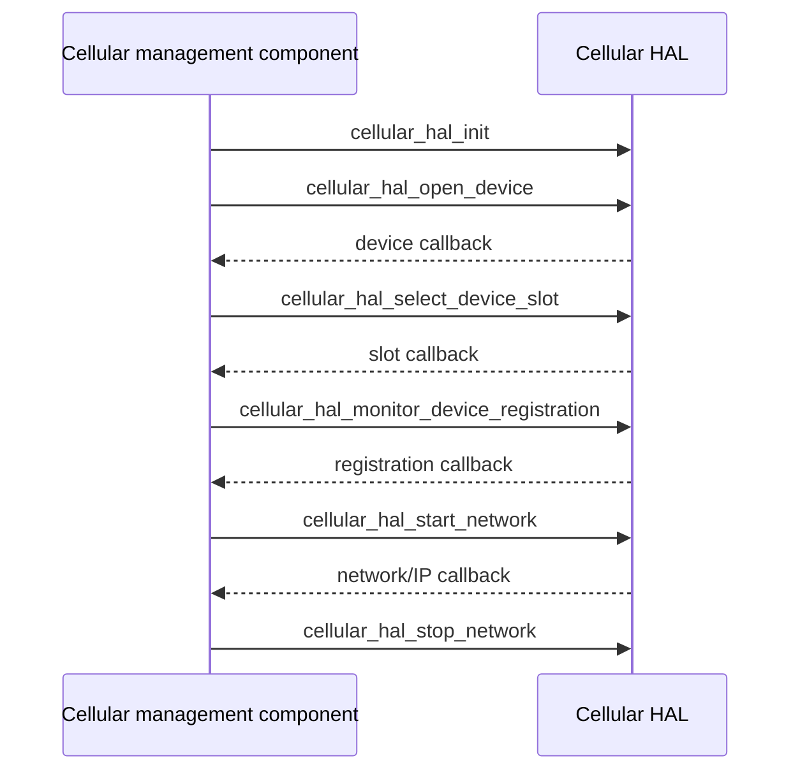

# Cellular HAL Specification

## Version History

| Date | Comment | Version |
| --- | --- | --- |
| — | Documentation alignment; no ABI change. | — |

## Acronyms
HAL means Hardware Abstraction Layer; UICC means Universal Integrated Circuit Card; SIM means Subscriber Identity Module; PLMN means Public Land Mobile Network.

## Description
The cellular management component uses this HAL for modem access, SIM selection, registration, packet-data profiles, network control, identity, and diagnostics. This is distinct from the three-operation Cellular Modem HAL.

## Optional Components
Slot count, radio technologies, profile support, and network availability depend on modem capabilities and product configuration.

## Component Runtime Execution Requirements
### Initialization and Startup
Call `cellular_hal_init`, open the device, select a slot, monitor registration, and create/select a profile before starting its network as required by the individual contracts.
### Threading Model
Serialize control operations unless the vendor explicitly guarantees concurrency.
### Process Model
The library integrates with the platform modem service. Coordinate other modem writers.
### Memory Model
Callers own supplied buffers. Follow per-function allocation and ownership exceptions in the header, particularly returned profile and network lists. Do not retain callback data without an explicit lifetime guarantee or a copy.
### Power Management Requirements
Use the SIM power and modem operating-configuration APIs for the corresponding hardware controls.
### Asynchronous Notification Model
Use the callback types declared for device opening, slot selection, registration, and network/IP status. Keep callback context valid and confirm callback execution threads.
### Internal Error Handling
Check per-function status and distinguish request acceptance from callback-observed completion. Reset and factory reset are disruptive.
### Persistence Model
Follow the product's profile persistence and reset requirements.

## Nonfunctional Requirements
### Logging and Debugging
Implementations must not log credentials, secrets, security-sensitive information, or other sensitive data. Log operation outcomes rather than payloads.
### Quality Control
Use warning-clean builds, static analysis, memory checks, and safe hardware-qualified lifecycle tests. Restore modem/SIM/profile state.
### Licensing
See repository Apache-2.0 notices.
### Build Requirements
Compile against the public header and link the product modem integration and dependencies.
### Variability Management
Use declared capability and slot information; do not infer support from enum values alone.

## Interface API Documentation
The linked header contains exact signatures, callback types, structure fields, bounds, and returns for this complete operation inventory.

| Area | Operations |
| --- | --- |
| Device | `cellular_hal_IsModemDevicePresent`, `cellular_hal_init`, `cellular_hal_open_device`, `cellular_hal_IsModemControlInterfaceOpened` |
| SIM/slot | `cellular_hal_select_device_slot`, `cellular_hal_sim_power_enable`, `cellular_hal_get_total_no_of_uicc_slots`, `cellular_hal_get_uicc_slot_info`, `cellular_hal_get_active_card_status` |
| Registration | `cellular_hal_monitor_device_registration`, `cellular_hal_set_modem_network_attach`, `cellular_hal_set_modem_network_detach` |
| Profiles | `cellular_hal_profile_create`, `cellular_hal_profile_delete`, `cellular_hal_profile_modify`, `cellular_hal_get_profile_list` |
| Network | `cellular_hal_start_network`, `cellular_hal_stop_network`, `cellular_hal_get_current_modem_interface_status` |
| Observations | `cellular_hal_get_signal_info`, `cellular_hal_get_cell_location_info`, `cellular_hal_get_packet_statistics`, `cellular_hal_get_current_plmn_information`, `cellular_hal_get_available_networks_information` |
| Identity | `cellular_hal_get_device_imei`, `cellular_hal_get_device_imei_sv`, `cellular_hal_get_modem_current_iccid`, `cellular_hal_get_modem_current_msisdn`, `cellular_hal_get_modem_firmware_version` |
| Configuration | `cellular_hal_set_modem_operating_configuration`, `cellular_hal_get_modem_preferred_radio_technology`, `cellular_hal_set_modem_preferred_radio_technology`, `cellular_hal_get_modem_current_radio_technology`, `cellular_hal_get_modem_supported_radio_technology` |
| Reset | `cellular_hal_modem_factory_reset`, `cellular_hal_modem_reset` |

### Theory of Operation and Key Concepts
Device readiness, SIM readiness, registration, and packet-data connectivity are different observations. A profile is not itself an active network. Observe IP/network callbacks after network initiation.

### Sequence Diagram

## Source References
- [cellular_hal.h](https://github.com/rdkcentral/rdkb-halif-cellular/blob/develop/include/cellular_hal.h)
